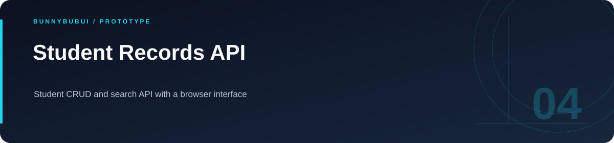

<p align="center">
  
</p>

<h1 align="center">Student Records API</h1>

<p align="center">Student CRUD and search API with a browser interface</p>

<p align="center">
     
</p>

<p align="center"><a href="#overview">ภาพรวม</a> · <a href="#features">ความสามารถ</a> · <a href="#start">เริ่มใช้งาน</a> · <a href="#structure">โครงสร้าง</a> · <a href="#validation">ตรวจสอบงาน</a></p>

<a id="overview"></a>

## ภาพรวม

ระบบฝึกจัดการข้อมูลนักศึกษาผ่าน Express และ MongoDB มี API สำหรับเพิ่ม อ่าน แก้ไข ลบ และค้นหา พร้อมหน้าเว็บสำหรับทดลองเรียกข้อมูล

<a id="features"></a>

## ความสามารถที่มีใน source

| ส่วนงาน | รายละเอียด | อ้างอิง |
|---|---|---|
| **CRUD** | เพิ่ม อ่าน แก้ไข และลบข้อมูลนักศึกษา | [ดู source](app.js) |
| **Search** | ค้นหาข้อมูลผ่าน API | [ดู source](app.js) |
| **Web client** | หน้าทดลองเชื่อม API | [ดู source](web%20api/) |

<a id="start"></a>

## เริ่มต้นใช้งาน

**สิ่งที่ต้องมี:** Node.js และ MongoDB ที่ localhost:27017; source เลือกฐานข้อมูล university และใช้พอร์ต 3000

```sh
npm install
node app.js
```

เปิด API ที่ http://localhost:3000/students ส่วนหน้าเว็บอยู่ใน `web api/` และมี endpoint บางส่วนจากรุ่นเก่าที่ควรเทียบกับ `app.js` ก่อนทดลอง

<a id="api"></a>

## API โดยย่อ

| Method | เส้นทาง | หน้าที่ |
|---|---|---|
| GET | `/students` | รายการนักศึกษา |
| POST | `/students` | เพิ่มรายการ |
| PUT / DELETE | `/students/:id` | แก้ไขหรือลบด้วย MongoDB ObjectId |
| GET | `/students/search?q=...` | ค้นหา |

<a id="structure"></a>

## โครงสร้างที่ควรเริ่มอ่าน

| ตำแหน่ง | หน้าที่ |
|---|---|
| [data/](data) | พื้นที่งาน / ไฟล์ประกอบ |
| [web api/](web%20api) | พื้นที่งาน / ไฟล์ประกอบ |

<a id="validation"></a>

## คำสั่งและผลตรวจ

repository นี้ไม่ได้กำหนดชุด automated tests สำหรับทุก flow; ตรวจผลจาก entry point และข้อมูลสาธิตที่เกี่ยวข้อง

<a id="scope"></a>

## ขอบเขตของงาน

ใช้ข้อมูลนักศึกษาสมมติในชุดสาธิต และเทียบ endpoint ฝั่งหน้าเว็บกับ API ก่อนใช้งานร่วมกัน

<a id="reading"></a>

## อ่านต่อ

- [บันทึกการเตรียม source](docs/CLEANUP.md)


---

<p align="center"><a href="https://github.com/BunnyBubui">BunnyBubui</a> · <a href="https://github.com/BunnyBubui/test">Software Portfolio</a></p>
